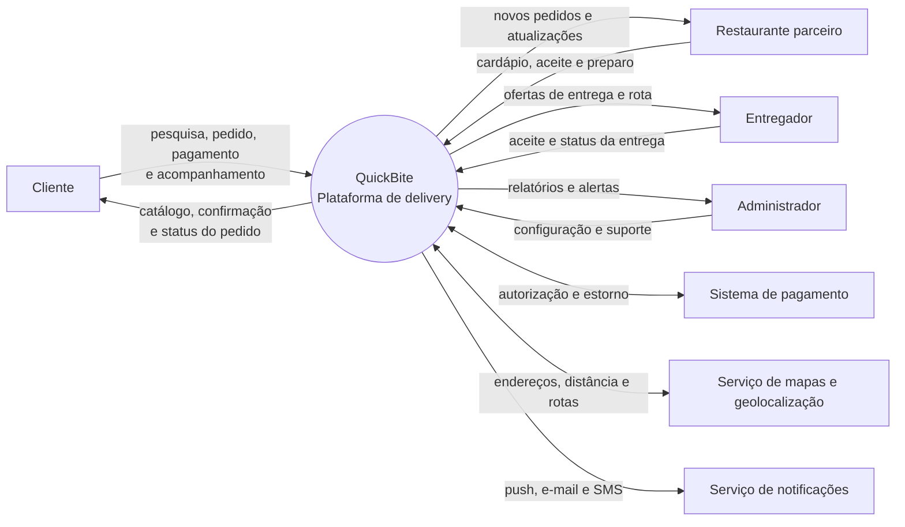
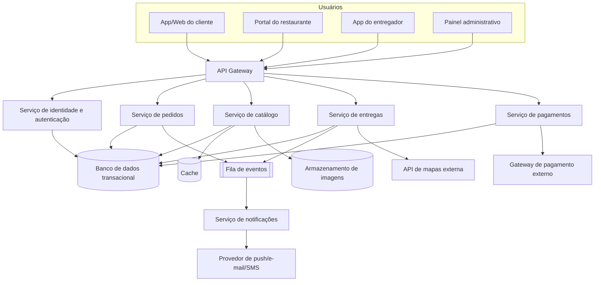
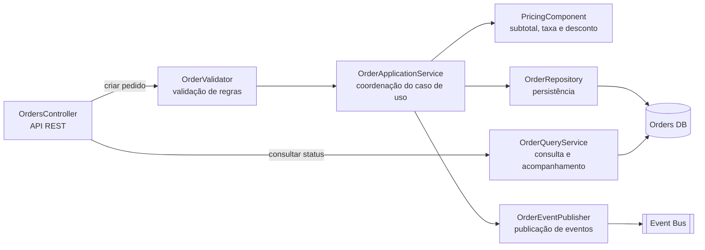

# Trabalho — Diagramas de Arquitetura

## Equipe

**Equipe:** 4 alunos (a mesma equipe será mantida nas demais atividades)

1. **Guilherme Reis Carvalho**
2. **Gabriel Krauss Selenko**
3. **Bento Barp**
4. **Vinicius Trevisan**

## Sistema escolhido

### QuickBite — plataforma de delivery

O QuickBite conecta clientes, restaurantes e entregadores. O cliente pesquisa restaurantes, monta o carrinho, realiza o pagamento e acompanha o pedido. O restaurante gerencia o cardápio e prepara os pedidos, enquanto o entregador aceita entregas e atualiza o status até a conclusão.

## Diagrama Nível 1 — contexto do sistema

Este nível apresenta o QuickBite como um único sistema e suas interações com os usuários e sistemas externos.

## Diagrama Nível 2 — containers da solução

Este nível detalha os principais blocos executáveis e de armazenamento que compõem a plataforma.

## Diagrama Nível 3 — componentes do Serviço de Pedidos

O Nível 3 detalha internamente o container mais importante para o fluxo de negócio: o Serviço de Pedidos.

### Principais componentes

| Componente | Responsabilidade |
|---|---|
| `OrdersController` | Receber requisições HTTP e devolver respostas da API. |
| `OrderValidator` | Validar cliente, itens, endereço, horário e dados obrigatórios. |
| `OrderApplicationService` | Orquestrar a criação, confirmação e atualização do pedido. |
| `PricingComponent` | Calcular subtotal, taxa de entrega, descontos e total. |
| `OrderRepository` | Persistir e consultar pedidos no banco transacional. |
| `OrderEventPublisher` | Publicar eventos como `PedidoCriado` e `PedidoConfirmado`. |
| `OrderQueryService` | Fornecer o status do pedido para cliente e parceiros. |

## Fluxo principal

1. O cliente escolhe itens e envia o pedido pelo aplicativo.
2. O API Gateway autentica a requisição e encaminha ao Serviço de Pedidos.
3. O pedido é validado, precificado e salvo no banco.
4. O Serviço de Pedidos publica um evento para restaurante, pagamento e entrega.
5. O cliente recebe a confirmação e acompanha as atualizações até a entrega.

## Premissas

- O pagamento é processado por um provedor externo, sem armazenamento dos dados completos do cartão no QuickBite.
- Os eventos permitem desacoplar pedidos, pagamentos, entregas e notificações.
- O banco transacional mantém a fonte oficial dos pedidos e de seus estados.
- Os nomes dos integrantes devem ser preenchidos pela equipe antes da publicação.

## Arquivo UML

O código-fonte dos diagramas UML em PlantUML está disponível em [`quickbite-diagramas.puml`](quickbite-diagramas.puml). Ele contém os diagramas de contexto, containers, componentes, classes, sequência e deployment.
